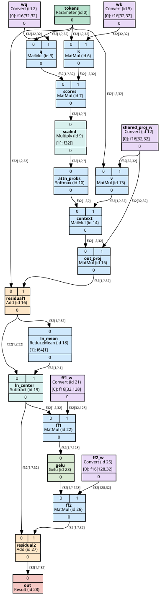

# ovgraph: OpenVINO model graph visualizer

Loads an OpenVINO IR model (`.xml` + `.bin`), turns it into a small framework-independent graph,
optionally transforms it with configurable passes, and draws it as an SVG with Graphviz.



* Original model is never modified (every pass runs on a copy).
* Built-in passes: **highlight** (red border) and **hide constants** (constants become rows on the node that uses them).
* Extra example pass: **fold_constant_converts**, which cleans up FP16 exports such as TinyLlama.

## 1. Getting started

Requirements: Python 3.10+, and the [Graphviz](https://graphviz.org/download/) `dot` program on your PATH
(check with `dot -V`).

```powershell
python -m venv .venv
.venv\Scripts\Activate.ps1          # cmd.exe: .venv\Scripts\activate.bat   Linux/macOS: source .venv/bin/activate
pip install -e ".[openvino,dev]"
python -m pytest -q                 # 72 tests
```

Try it on the bundled example models:

```powershell
python -m ovgraph examples\models\mini_transformer.xml -o out.svg --hide-constants --highlight-op MatMul
```

## 2. Usage

```
ovgraph MODEL.xml [-o OUT.svg] [pass flags in the order you want them applied] [--attrs]
                  [--no-edge-labels] [--fast | --no-fast] [--timing]
```

With no pass flags the model is drawn as it is (no transformations).

**Passes run in the order their flags appear on the command line.** The order can matter
(see `fold_constant_converts` below), so this is deliberate.

| Flag | What it does |
|---|---|
| `--hide-constants` | Remove Constant nodes. Each consumer gets a row per constant input: `[1]: f32[768,768]`. If a constant feeds several consumers the row ends with `(shared: <node id>)`. Only dtype and shape are shown, never values. |
| `--highlight-name NAME` | Red border on every node with this name (repeatable; names need not be unique, all matches light up). |
| `--highlight-op OP` | Red border on every node of op type `OP` (repeatable, e.g. `MatMul`). |
| `--highlight-id ID` | Red border on the node with this id (the number in each box, e.g. `MatMul (id 7)`). |
| `--pass SPEC` | Run any registered pass: `NAME` or `NAME:key=value;key=value` (repeatable). Values can be comma lists. Example: `--pass "highlight:names=q,k;color=blue"`. Names may use `-` or `_`. |
| `--attrs` | Show node attributes (hidden by default, they are long). |
| `--no-edge-labels` | Leave dtype/shape off the edges (smaller and faster). |
| `--fast` / `--no-fast` | Force the fast layout on or off. Default: automatic above 400 drawn nodes. |
| `--timing` | Print graph size (nodes and edges), load / transform / render time and the environment (stderr). |

Pass options: `hide_constants` takes `type` (the op type to hide, default `Constant`);
`highlight` takes `names`, `ids`, `ops`, `color`; `fold_constant_converts` takes none.
Bad input (missing file, corrupt model, unknown pass or option, non-numeric id) gives a one-line
`error: ...` and exit code 1; a malformed `--pass` spec is an argparse usage error (exit code 2).

Examples:

```powershell
# no transformations
python -m ovgraph examples\models\mini_transformer.xml -o full.svg
# hide constants, then highlight two nodes by name
python -m ovgraph examples\models\mini_transformer.xml -o out.svg --hide-constants --highlight-name q --highlight-name k
# same, written with --pass specs
python -m ovgraph examples\models\mini_transformer.xml -o out.svg --pass hide-constants --pass "highlight:names=q,k"
```

Each box shows the node name, `OpType (id N)`, input ports on top, output ports at the bottom, and any
rows added by passes. Edges carry `dtype[shape]`; a `?` is a dynamic dimension.

As a library:

```python
from ovgraph.loaders import load_graph
from ovgraph.passes import Pipeline, HideConstantsPass, HighlightPass
from ovgraph.render import GraphvizRenderer

g = load_graph("model.xml")
pipe = Pipeline([HideConstantsPass(), HighlightPass(names=["q", "k"])])   # applied in this order
g2 = pipe.run(g)                                                           # g is untouched
pipe.set_enabled("hide_constants", False)                                  # switch a pass off, keep the rest
GraphvizRenderer().render_svg(g2, "out.svg")
```

## 3. Architecture

```
model file --> Loader --> Graph (Nodes + Edges) --> Pipeline of Passes --> Renderer --> SVG
```

| Module | Job |
|---|---|
| `graph.py` | `Node` (int id, name, op type, attributes, `meta` for notes between passes and renderer), `Edge` (src/dst id and **port**, shape, dtype; frozen), `Graph`. |
| `loaders/` | Turn a file into a `Graph`. Only `openvino_loader.py` imports OpenVINO (lazily). |
| `passes/` | `Pass` base class, `Pipeline`, and a name registry. |
| `render/graphviz_renderer.py` | Graph to Graphviz HTML-like table labels with a port cell per input/output, so edges attach to the right port. |
| `cli.py` | Argument parsing and wiring. |

Design choices:

* **Graph is independent of OpenVINO.** Only the loader knows OpenVINO, so passes and the renderer are testable without a model.
* **Nodes are keyed by an integer id, not by name**, because names are not unique.
* **Edges are a list, not a dict keyed by `(src, dst)`**, because two nodes can be joined by several edges (different ports).
* **Passes never mutate the input.** `Pipeline.run` clones the graph first (deep copy of nodes, shallow copy of the edge list because `Edge` is frozen).
* **Passes talk to the renderer through `node.meta`** (`border_color`, `extra_rows`), so the renderer does not need to know about specific passes.

## 4. Extensibility

Add a pass: subclass `Pass`, implement `run`, decorate it. It is then available as `--pass NAME`.

```python
from ovgraph.passes import Pass, register_pass

@register_pass
class MyPass(Pass):
    name = "my_pass"
    def run(self, graph):          # graph is already a private copy; mutate and return it
        for n in graph.nodes.values():
            if n.op_type == "Softmax":
                n.meta["border_color"] = "blue"
        return graph
```

Add a model format: subclass `Loader` (`name`, `extensions`, `load(path) -> Graph`) and decorate it with `@register_loader`;
it is picked by file extension or `--format`. Nothing else changes.

A pass that takes options overrides `from_options(options: dict[str, list[str]])` (see `HighlightPass`); then the
CLI can configure it with `--pass "name:key=value"` without any CLI change.

### The custom pass: `fold_constant_converts`

FP16 exports (like TinyLlama) store each weight as `Constant(f16) -> Convert(f32) -> layer`.
Hiding constants alone leaves one useless Convert box per weight. This pass removes a Convert whose only input is a
Constant and joins the Constant directly to the Convert's consumers with the Convert's output dtype, so `hide_constants`
then shows `[1]: f32[2048,2048]`. Converts on real activations are left alone.
It must run **before** `hide_constants` (once the Constants are hidden there is nothing left to fold), so pass it first on the command line.

```powershell
python -m ovgraph models\tinyllama\openvino_model.xml -o tinyllama_before.svg --hide-constants
python -m ovgraph models\tinyllama\openvino_model.xml -o tinyllama_after.svg  --pass fold_constant_converts --hide-constants
```

On TinyLlama this takes the drawn graph from **1911 to 1528 nodes**. Small demo:
`examples/svg/fp16_before.svg` vs `examples/svg/fp16_after.svg`.

## 4b. Making big graphs readable

**What made TinyLlama hard to read.** Measured on the post-pass graph (1528 nodes, 2025 edges, `tinyllama_after.svg`):

* Seven nodes with more than three outgoing edges (shared inputs such as `beam_idx`, the position ids and the attention
  mask, each feeding all 22 layers) are 12% of the edges but about **75% of the total edge length**. Their edges have a
  median length of about 17,500 pt on a 98,558 pt tall page, so they cross the whole picture.
* The page is about 98,000 pt tall because the 22 identical decoder layers form one long chain.
* Nodes are wide (median about 300 pt) because the node name is long, e.g. `__module.model.layers.0.self_attn/aten::...`.

**What was added** (each one is optional and they combine):

| Option | What it does |
|---|---|
| `--hide-names` | Boxes show only `OpType (id N)`; median width drops from about 300 to about 100 pt. |
| `--node-map map.json` | Writes node id -> name, op type, attributes, constant rows, collapsed edges and group members, so nothing hidden is lost (including the edges folded inside module boxes, under `folded_edges`). |
| `--collapse-fanout` | A node with more than 3 outgoing edges (`--pass collapse_fanout:threshold=N` to change it) stops drawing them. The source gets `out[0] -> 44 consumers (collapsed)`, each consumer gets `[1]: from id 9: i64[1]`, and the edges are listed in the JSON. Run it **after** `--hide-constants`. |
| `--collapse-modules` | One box per module, found from the node name (default pattern `layers\.\d+`). Edges inside a module vanish; edges between boxes merge into one labelled `N edges`. `--pass collapse_modules:expand=layers.0` leaves one layer unfolded to look inside it. Nodes with generated names (`Gather_70871`, the KV-cache plumbing) are pulled into the box of the layer they only talk to; `absorb=false` turns this off. Run `collapse_modules` **before** `collapse_fanout`. |

```powershell
# readable overview: one box per layer, shared inputs collapsed, short boxes
python -m ovgraph models\tinyllama\openvino_model.xml -o tinyllama_overview.svg --node-map tinyllama_overview.json `
    --pass fold_constant_converts --hide-constants --collapse-modules --collapse-fanout --hide-names

# the same, with layer 0 shown in full
python -m ovgraph models\tinyllama\openvino_model.xml -o tinyllama_layer0.svg --node-map tinyllama_layer0.json `
    --pass fold_constant_converts --hide-constants --pass collapse_modules:expand=layers.0 --collapse-fanout --hide-names
```

**Effect** (real TinyLlama graph, 2 logical CPUs, Graphviz 2.43; page sizes vary a little between Graphviz versions):

| Setup | Drawn nodes / edges | Layout time | SVG page size (pt) |
|---|---|---|---|
| after passes (before this work) | 1528 / 2025 | 111 s | 6413 x 93025 |
| + `--collapse-fanout` | 1528 / 1779 | 1.7 s | 4880 x 96957 |
| + `--hide-names` | 1528 / 1779 | 1.9 s | 2219 x 89001 |
| + `--collapse-modules` (overview, before absorb) | 314 / 321 | 0.2 s | 5489 x 3564 |
| + `--collapse-modules` with absorb (overview) | 90 / 98 | 0.1 s | 1476 x 4595 |
| overview with `expand=layers.0` | 373 / 389 | 0.2 s | 5917 x 7440 |

Nothing is lost: in every setup all 2025 original edges and all 1528 nodes can be recovered from the picture plus the node map JSON (checked on this graph).
Removing the 246 long fan-out edges also made `dot` about 60x faster, which fits the finding that they were what made the layout expensive.

Hiding names and fan-out edges make the picture narrower and remove the longest edges, but only grouping fixes the height.
In the overview the 292 nodes outside any layer are mostly the KV-cache plumbing (`ReadValue`, `Gather`, `Concat`,
`Broadcast`, `Assign`: about ten per layer), because their names do not contain `layers.N`. Folding those into their layer is the next step.

## 5. Examples

Three models, with generated SVGs:

| Model | How to get it | SVGs |
|---|---|---|
| `mini_cnn` | `python examples/make_models.py` | `examples/svg/mini_cnn_full.svg`, `mini_cnn_hidden.svg` |
| `mini_transformer` (dynamic sequence length, one shared weight) | same script | `examples/svg/mini_transformer_full.svg`, `mini_transformer_hidden.svg` |
| TinyLlama-1.1B-Chat (3168 nodes) | `optimum-cli export openvino --model TinyLlama/TinyLlama-1.1B-Chat-v1.0 --weight-format fp16 models/tinyllama` | `tinyllama_full.svg` (no passes), `tinyllama_before.svg` (constants hidden), `tinyllama_after.svg` (constants hidden + custom pass) |

Regenerate the small SVGs with `python examples/generate_svgs.py`.

## 6. Testing

```powershell
python -m pytest -q      # 72 tests, about 6 s
```

* Graph: node and edge creation, unique ids with duplicate names allowed, several edges between the same pair of nodes
  (different ports), edge to an unknown node rejected, clone independence, dynamic and missing shapes.
* Passes (on small synthetic graphs, independent of parsing and rendering): highlight by name / id / op type, only the
  matching nodes change, hide_constants with single and shared constants (port kept, `(shared: id)` marker, unrelated edges
  kept), constants removed only when no visible connection remains, the original graph untouched.
* Pipeline: passes run in the given order, order changes the result, a disabled pass is skipped, pass options are parsed.
* Renderer: DOT has ports and edge ports, highlight becomes a red border, names are HTML-escaped, SVG is produced, fast
  layout switches on automatically for big graphs.
* Model parsing and end to end: build a small IR with OpenVINO, check op types, port indices, shapes and dynamic dims,
  run the real CLI with passes and check the SVG (needs `dot`; skipped without it). Pass order on the command line.
* Error paths: missing file, corrupt model, unknown extension, unknown pass or option give a clean message and exit code 1.
* The example models and the custom pass are covered too.

## 7. Performance

**Testing environment:** Windows 11 laptop, 8 logical CPUs, Python 3.14.4, OpenVINO 2026.4.1, Graphviz 16.1.0
(the line `--timing` prints). Times are single runs.

**TinyLlama-1.1B-Chat-v1.0** (FP16 export, `--timing`):

| run | loaded | drawn | load | transform | render |
|---|---|---|---|---|---|
| no passes (`tinyllama_full.svg`) | 3168 nodes, 3741 edges | 3168 nodes, 3741 edges | 0.47 s | 0.02 s | 17.3 s |
| `--hide-constants` (`tinyllama_before.svg`) | 3168 nodes, 3741 edges | 1911 nodes, 2429 edges | 0.44 s | 0.02 s | 9.2 s |
| `--pass fold_constant_converts --hide-constants` (`tinyllama_after.svg`) | 3168 nodes, 3741 edges | 1528 nodes, 2025 edges | 0.43 s | 0.02 s | 8.9 s |

**Synthetic chains** (`python examples/benchmark.py`; about 40% constants), hide + highlight passes, fast render.
This is where the 5,000-node target is checked:

| nodes | edges | passes | drawn | render |
|---|---|---|---|---|
| 501 | 665 | 0.002 s | 334 | 0.81 s |
| 999 | 1329 | 0.006 s | 666 | 0.95 s |
| 2499 | 3329 | 0.015 s | 1666 | 0.98 s |
| 5001 | 6665 | 0.031 s | 3334 | 1.55 s |

* Loading and passes are cheap; **Graphviz layout is the bottleneck**.
* Memory: a pipeline run makes ONE copy of the graph (nodes are deep-copied because passes edit their `meta`; the frozen
  edges are shared, only the list is new). Passes then edit that copy in place, so no pass copies the graph again.
* Curved edge routing was the main cost. Above 400 drawn nodes the renderer switches to a fast layout
  (`splines=line`, reduced `nslimit`/`mclimit`, no `remincross`). Without it, the full TinyLlama graph did not finish in a reasonable time.
* The benchmark caught an O(E^2) loop in `hide_constants` (it looked up each shared constant's consumers once per edge).
  It now counts consumers in one pass, which made that pass about 20x faster at 5k nodes.

## 8. Known limitations

* Only OpenVINO IR (`.xml`) is supported; other formats need a new loader.
* Subgraphs (`Loop`, `TensorIterator`, `If` bodies) are not expanded: they appear as a single node.
* Fast layout uses straight edges, so edges can cross nodes on big graphs. `--no-fast` gives nicer routing but is far slower.
* Constant values are never read; only dtype and shape are shown.
* `fold_constant_converts` assumes the `Constant -> Convert` pattern; other quantisation patterns (e.g. decompression with Multiply/Subtract) are not folded.
* Finding the in/out edges of one node scans the whole edge list (O(E)). Fine at this size; an adjacency index is the next step if profiling shows a need.
* Very large SVGs (several MB for TinyLlama) are slow to open in some viewers; use a browser.
* `collapse_modules` finds the module from the node name only. Nodes with a properly named non-layer role (embeddings, final norm, mask building) and generated nodes shared between several layers stay outside the boxes.
* `collapse_fanout` counts all outgoing edges of a node; the removed edges exist only in the node map JSON, not in the picture.
